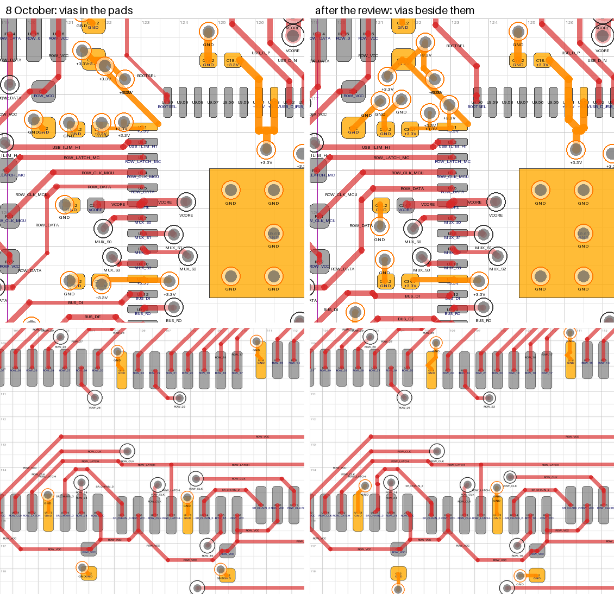

# Design review — 21 October 2026

An experienced electrical engineer looked over the routed rev-4 board and made
six comments. Each was measured on the board as committed (`050e8a4`) by
`verify/layout/review.py`, judged against this board's actual signals and
JLCPCB's published rules, and, where it holds, fixed on the installed board by
`tools/review_rev4.py`. The result was checked the way every earlier change
was: KiCad's DRC with zones refilled, schematic parity, the netlist assertions
and fault injection, the plane checks, and the layout measurements of
`VERIFICATION.md`.

| # | comment | does it hold here? | what changed |
|---|---|---|---|
| 1 | "Move your vias out of any component pads, it can cause issues when reflowing" | **Yes.** 98 ground and +3.3 V vias had their holes in SMD pad openings, 32 of them on one pad of a two-pad passive, which is how 0201s and 0402s tombstone. The board relied on epoxy-filled, capped vias, a paid option on a 4-layer JLCPCB board, to stay safe | 97 moved out or taken off. One stays, at U5 pin 15, besides the exposed pads' 9. Tented vias are now enough; filling is optional |
| 2 | "Some of your signal lines change size randomly … can cause reflections" | **The width changes were real; the reflections are not a problem at these lengths.** 231 mm of signal track was 0.10 mm, 119 mm of it on tracks outside the fine-pitch areas, where the board's own rule says 0.15 mm, and 17 nets changed width along their length. A 0.10 / 0.15 mm step is a 6 % impedance step on lines that are electrically short | 0.10 mm signal track down to 94 mm; outside the fine-pitch areas 45 mm, on four slow nets the board rule now names. 10 nets change width |
| 3 | "The small traces should be fine for 3v3" | **Agreed.** +3.3 V is the In2 plane; its tracks are pad-to-via ties, the longest segment 3.4 mm. 0.15 mm of outer copper carries 0.6 A; the rail draws under 0.1 A | nothing |
| 4 | "Right angles on your bus lines" | **There were right angles**: 24 bare 90° corners, 6 of them on the RS-485 pairs where they swap and cross at J4. **They cost nothing measurable here**: under 1 ps each, and a reflection of about 0.01 % of the fastest edge on these lines | 20 cut to two 45° bends, all 6 on the pairs among them. 8 are left, 3 of them on the regulator and ADC corners' drawn nets |
| 5 | "High speed traces should be above a ground pour … keep them on the top layer" | **True in principle, small in practice.** B.Cu runs over the +3.3 V plane, so a signal that changes layer sends its return current through the nearest +3.3 V–GND capacitor. On this board the fast nets that change layer do so where pin order forces a crossing | fast logic on B.Cu 37 → 36 mm: routing them again found little better |
| 6 | "Some of your components are pretty close to the edge" | **Yes, four parts.** C39, R1 and R17 had copper 0.27 mm from the outline and D3 0.37 mm: inside JLCPCB's 0.4 mm for a V-scored edge, with its ±0.2 mm outline tolerance eating the solder-mask web | the four moved in to 0.50–0.75 mm; the copper-to-edge rule is now 0.40 mm |

## 1. Vias in component pads

> Move your vias out of any component pads, it can cause issues when reflowing.

**Holds.** An open via hole inside a pad's solder-mask opening drains solder
during reflow. A capacitor or resistor that loses solder on one pad only is
pulled upright by the other: a tombstone. An IC pin that loses it is a starved
joint. Measured on the board (a via counts when its hole meets an SMD pad's
mask opening; the pads here have no mask expansion, so that is the copper):

| | 8 October | now |
|---|---|---|
| via holes in an SMD pad opening, exposed pads aside | **98** (all ground or +3.3 V plane ties) | **1** (U5 pin 15) |
| …or within 0.10 mm of one (JLCPCB's minimum solder-mask bridge) | 0 | 0 |
| two-pad passives with a hole at one pad only | **32** (C1–C4, C6, C7, C12, C14, C15, C20, C21, C24, C25, C29, C35–C40, C42, D3, R1, R2, R5, R7, R9, R20, R26, R27, R32, R33) | **0** |
| holes in the exposed pads (U9's 7, U12's 2) | 9 | 9 |

The board coped by requiring epoxy-filled, copper-capped vias
(`fab/ORDER-NOTES.txt`: "required"). That works, but JLCPCB makes it the
default only from 6 layers and charges for it on 4, and nothing in KiCad's
checks stood in the way of ordering without it.

*F.Cu round U9's west side (top) and the 595s U3 / U4 (bottom), ground and
+3.3 V in orange. On 8 October (left) the plane vias sit in the capacitors'
and pins' pads; now (right) they sit beside them, with short ties. U9's
exposed-pad vias stay.*

**What changed.** Three of the vias went with the parts that moved in from the
edge (C39, R1, D3). `tools/review_rev4.py` moved the others, each to the
nearest place where its hole is at least 0.10 mm from every pad opening,
preferring places where the whole via land is that far clear, with a straight
or one-bend octilinear tie. Where the via sat in a pad that also had a track to
somewhere else (a capacitor's to its IC pin), that track stays as it was, so
every supply pin keeps its path to its capacitor. 77 vias moved straight away,
74 of them with the whole land clear. 12 more were boxed in by signal copper,
so the nets in the way were taken up and routed again round them (`COL_9`,
`COL_10`, `COL_15`, `COL_24`, `MUX_S0`, `MUX_S1`, `SR_CHAIN_3`, `ROW_CLK`,
`BUS_DI`, `USB_BUS_EN`, `BOOTSEL`, `USB_ILIM`, `USB_PWR_FAULT`, `USB_SNUB`,
`RUN`, `+5V`), each kept only if it came out whole with no more vias and not
much longer. A flag line was allowed a few more vias, so `USB_PWR_FAULT` now
has 4. Five vias that found no place were taken off: the GND vias of one
mounting pad on each FFC connector (J1, J2), of R2.2 and of U13.10, and
C34.1's +3.3 V via. Each pad they served is tied on F.Cu to a neighbour's
via, or was already on the plane through another (R2.2's tie with `AMP_B`
routed again). The vias are tented, so solder mask now covers them. Every plane via was checked
against KiCad's own fill of its plane. One that had moved into the
thermal-relief gap round J5's shield pin reached no plane, and was moved
again. A new board rule (`rev4.kicad_dru`, "via hole clear of SMD pads")
makes KiCad's DRC hold all this from now on: on the old board, before its one
exception was added, it flagged exactly the 98.

**What stays.** U5 pin 15, the second mux's enable, is tied to ground, and its
via sits at the toe of the pad, boxed in by `MUX_S0`'s via, `MUX_S2` and
`COL_15` on F.Cu and column lines on B.Cu. Every place clear of the pads meant
taking up two to seven of those nets, and no attempt routed them all again
whole and no longer. The board rule names it.

The 9 ground vias in the exposed pads of U9 (RP2354A) and U12 (TPS62162) are
where both makers' reference layouts put them. The exposed pad is the
RP2354A's main ground, and the TPS62162's carries its heat. Their paste
windows sit over the holes. With plain vias some of that paste drains into
them and leaves voids under the pad; filled, capped vias stop that. So the
order notes now read: **tented vias are enough; filled and capped vias are
optional, and only help U9's and U12's exposed pads and U5 pin 15**.

The price is a short tie between each pad and its via, where there was none.
The decoupling capacitors whose ground via sat in the pad now reach it
through 0.4–1.0 mm of track, and those whose via was beside the pad but too
close through 0.5–1.3 mm (was 0.35). At about 0.45 nH per mm for a 0.15 mm
track over the ground plane, that adds 0.2–0.5 nH to a capacitor's path to
the plane: the usual cost of vias beside pads rather than in them. Every IC
supply pin reaches its capacitor along F.Cu as before, at the same distance
or less (`verify/layout/decap.py`: the RP2354A's at 1.00–2.88 mm).

## 2. Signal widths that change along a net

> Some of your signal lines change size randomly. This is usually fine for
> static traces like power but can cause reflections in signals.

**The width changes were real; the reflections are not a problem on this
board.** Freerouting routes each net class at one width from end to end, so
every net touching the RP2354A or the TUSB320 came back at the fine-pitch
0.10 mm. `fr_finish.py` widened those back to 0.15 mm wherever the clearance
allowed, which left 0.10 mm wherever a neighbour sat at minimum clearance:
widths that change for no visible reason.

| | 8 October | now |
|---|---|---|
| signal track at 0.10 mm | 231 mm | 94 mm |
| …outside the fine-pitch escape areas | 144 mm on 16 nets | 61 mm on 7 nets |
| …on tracks that never enter them (what the new rule covers) | 119 mm on 12 nets | 45 mm on 4 nets: `MUX_S0` 24.6, `MUX_S3` 8.3, `SYNC_DE` 5.9, `MUX_S2` 5.8 |
| nets with more than one width | 17 | 10 |
| width steps off any pad | 60 | 22 |
| the RS-485 and USB pairs | 0.15 mm throughout | 0.15 mm throughout |

On this stackup a 0.15 mm track is about 76 Ω and a 0.10 mm one about 86 Ω
(IPC-2141, as `VERIFICATION.md` uses), so each step reflects about 6 % of an
edge. A step matters only when the line is long against the edge: for a 1 ns
edge, the usual limit of a sixth of its length is about 28 mm at this board's
5.9 ps/mm. The thin stretches were mostly a few millimetres long, and the long
ones were on the mux selects (`MUX_S0` had 46 mm at 0.10 mm), which switch once
per channel and then sit still for the 6.6 µs settle. So nothing here was
ringing, but the widths broke the design's own rule and cost etching margin.

**What changed.** Every net with 0.10 mm track away from the fine-pitch pins
was taken up and routed again at 0.15 mm, end to end, and kept where it came
out whole, with no more vias and at most a third longer. Six did: `BUS_DI`,
`ROW_DATA`, `SYNC_OUT`, `BUS_DE`, `STATUS` (6 mm shorter) and `USB_PWR_FAULT`.
What was left was widened in place where the clearance allowed. A segment
packed against a neighbour was nudged up to 0.075 mm aside where that made
room, its joints sliding along the segments either side so every angle
stays. Then each remaining run outside the escape areas was routed again on
its own in a small window (7 of 13 went). A board rule ("0.15 mm outside the
escape areas") now holds it; on the old board, before its exceptions, it
flagged 45 tracks. It names the four nets that keep runs at 0.10 mm, where no
way at 0.15 mm was found: `MUX_S0` among the column lines on B.Cu, `MUX_S2`
and `MUX_S3` between the two muxes, and `SYNC_DE`, the master's frame-start
enable, pulsed once a frame.
Inside the two escape areas 0.10 mm remains where the 0.4 mm-pitch pins need
it, and a track that starts there may finish its run at 0.10 mm, as the rule
allows (16 mm, mostly `MUX_S0` and `BUS_RO` leaving U9).

## 3. 3.3 V track widths

> The small traces should be fine for 3v3 across them unless your components
> draw crazy current for some reason.

**Agreed; nothing changed.** +3.3 V is distributed by the In2 plane. Its
tracks are pad-to-via ties (58.5 mm in all, the longest single segment
3.4 mm), 0.15 mm wide except 1.2 mm of 0.10 mm in U9's pin ring. IPC-2221's
chart gives 0.15 mm of 1 oz outer copper 0.60 A for a 10 °C rise, and 0.10 mm
0.45 A. The whole rail draws 20–34 mA, plus about 35 mA while a board
transmits (`VERIFICATION.md`). The narrowest carrier of real current is
`ROW_VCC`, the row excitation: 56.8 mm at 0.15 mm, 0.19 Ω, which drops 0.4 mV
at a fully pressed row's 2.1 mA, and the reading is ratiometric to the same
rail anyway. After the via moves the +3.3 V ties total 63.5 mm, the longest
segment 2.7 mm.

## 4. Right angles on the bus lines

> There are right angles on your bus lines which isn't ideal for what I
> assume are high speed traces.

**There were right angles; they did nothing measurable.** Counting corners
where two segments of a net meet away from any pad or via:

| | 8 October | now |
|---|---|---|
| 90° corners, RS-485 / USB pairs | 6: BUS_P ×2, BUS_N ×1, SYNC_P ×3, all at the J4 end where each pair swaps P and N and the two pairs cross | **0** |
| 90° corners, other signals | 14 | 7 |
| 90° corners, power and plane ties | 4 | 1 |
| sharper than 90° | 0 | 0 |

Howard Johnson measured a right-angle bend in an 8-mil (0.2 mm), 50 Ω FR-4
microstrip at about 1 ps of delay and 0.012 pF, a reflection of 0.3 % for a
100 ps edge, scaling with track width over rise time. On this board's 0.15 mm,
76 Ω tracks that is under 1 ps and about 6 fF. The fastest edge on these lines
is the SN65HVD75's: 2 ns minimum, 7 ns typical driver rise time (TI datasheet,
54 Ω / 50 pF), against an 80 ns bit at the planned 12.5 Mbaud, so a corner
reflects about 0.01 % of it. The reason to avoid corners in etching is acute
angles, which trap acid; this board has none.

**What changed** anyway, since it costs nothing: 20 corners were cut to two
45° bends, each with the largest chamfer the exact check passed, all six on
the pairs among them. Eight are left. Two are on column lines at J2 with no
room for a chamfer (`COL_3`, `COL_16`). Two are on lines routed again round a
moved via: a bend on `MUX_S1` and a 0.03 mm jog on `SR_CHAIN_3`. Three are on
the drawn nets, `RAIL_MON`'s two at the ADC corner and `VCORE`'s, left exactly
as drawn.

## 5. Fast traces over ground

> In general, any high speed traces should be above a ground pour. So in your
> board, you should try to keep them on the top layer whenever possible.

**True in principle; on this board it is about return paths, not signal
integrity.** The stackup is F.Cu / In1 GND / In2 +3.3 V / B.Cu
(JLC04161H-7628). A B.Cu track is a microstrip over the +3.3 V plane, 0.21 mm
below it: as good a reference for its impedance as ground, and solid under
almost all of it (`verify/layout/refplane.py`: 93–95 % of the USB-C pair's
B.Cu run). The cost is at the vias. When a signal moves between F.Cu and B.Cu
its return current has to move from In1 to In2. The two planes are a 1.07 mm
core apart, which gives only about 70 pF between them across the whole board,
so in practice the return current goes through the nearest +3.3 V–GND
capacitor. That makes a loop, which matters for emissions and crosstalk more
than for the signal itself. Every net here is electrically short: the
longest fast net is the 54 mm RS-485 pair, against 56 mm for a sixth of the
SN65HVD75's fastest 2 ns edge.

| signal copper, F.Cu / B.Cu | 8 October | now |
|---|---|---|
| fast logic: 595 clock, data, latch, chain; RS-485 transceivers' DI / RO / DE | 139 / 37 mm | 142 / 36 mm |
| the pairs: RS-485 BUS and SYNC, USB | 198 / 83 mm | 196 / 83 mm |
| everything else (mux selects, columns, address straps, debug, status) | 717 / 604 mm | 697 / 610 mm |

The fast logic nets were taken up and routed again with B.Cu costed, kept on
the same terms as the widths. That found little: `BUS_DI`'s B.Cu run went from
5.6 to 5.1 mm and `ROW_DATA`'s from 5.7 to 5.5 mm, and `ROW_CLK`, `BUS_RO` and
`SYNC_DE` found nothing better. What is on B.Cu, and why it stays:

- **`ROW_CLK`** (the 595s' shift clock), 8 mm on B.Cu through 4 vias. On each
  74LVC595 the clock pin (11) sits between `ROW_VCC` (pin 10, which is tied to
  pin 16 on both sides of the pin row) and the latch (pin 12), so on two
  signal layers either the clock or the excitation rail has to change layer
  at each chip. An attempt to route it on F.Cu only, letting the chain links
  take the vias, found no way through without re-routing the row-excitation
  rail. Its vias are 5–11 mm from a +3.3 V–GND capacitor; the 595s' own
  decoupling is on `ROW_VCC`.
- **The USB-C pair** (USB full speed, 12 Mbit/s, rise time 4–20 ns by the USB
  2.0 specification), 19–22 mm on B.Cu. It runs from J5 below U9 to the
  series resistors above it, and has to cross the F.Cu-only analog nets that
  leave U9's east side (`ADC_A`, `ADC_B`, `RAIL_MON`) and the op-amp outputs.
  Its four vias are 4–7 mm from a +3.3 V–GND capacitor. Differential
  signalling returns most of its current in the partner line.
- **The SYNC pair**, 18 / 21 mm on B.Cu: the crossing under BUS at J4 that the
  swapped J3 / J4 pinout forces, and 10 mm past the USB-C receptacle where the
  R27 / R28 / Q1 / D2 group leaves no room for four tracks on F.Cu.
  Differential again.
- **The rest** is slow or static: mux selects, column lines, address straps,
  the debug header lines and the status and power-control lines.
  `USB_PWR_FAULT`, a fault flag, picked up 6.9 mm of B.Cu where it was routed
  again round a moved via.

If emissions testing ever points at the bottom layer, the standard remedy is a
100 nF +3.3 V–GND stitching capacitor beside the layer changes of `ROW_CLK`
and the USB-C pair. That is a parts change, not made here.

## 6. Parts close to the edge

> Some of your components are pretty close to the edge which will make it hard
> to soldermask.

**Holds for four parts.** Copper to the outline's centre line, where the
router cuts:

| part | 8 October | now |
|---|---|---|
| C39, 10 µF 0805 on +5V_BUS at J4 | 0.27 mm | 0.75 mm |
| R1, 10 k SENSE_A pull-down | 0.27 mm | 0.50 mm |
| R17, 1 k status-LED resistor | 0.27 mm | 0.50 mm |
| D3, status LED | 0.37 mm | 0.50 mm |
| tracks and vias under 0.40 mm | 2 vias in J4's shield tabs, R1's ground via, a +5V via and 22 mm of +5V track along the bottom edge | none |

JLCPCB's rules are 0.2 mm of copper to a routed edge and 0.4 mm to a V-scored
one, with ±0.2 mm outline tolerance for regular routing and a 0.10 mm minimum
solder-mask bridge (green; 0.13 mm for black or white). At 0.27 mm the mask
between pad and edge can be cut through, and a V-scored rail would come too
close. C39 is also an 0805 MLCC, the kind that cracks when a panel is broken
apart near it. The four parts moved straight in, square to their edge, and
their ties were drawn again (`PLACEMENT.md`). The board's copper-to-edge rule
went from 0.22 to 0.40 mm, so KiCad's DRC holds every track, via and pad to the
V-cut figure. The +5V run along the bottom edge on B.Cu, 0.35 mm from it, was
routed again as R17 and D3 moved and is now 1.15 mm in. R1's ground via moved
with R1, and J4's two shield-tab ground vias with the other vias.

The connectors stay at the edges, which is their job: J1 / J2 (the FFCs)
overhang it by design, J3 / J4 (0.50 mm), J5 and J6 take cables there.
JLCPCB's assembly terms want parts 2.5 mm from the edge or 5 mm rails, which
this board needs anyway (`fab/ORDER-NOTES.txt`).

## Checked after the changes

| check | result |
|---|---|
| KiCad 10.0.7 DRC, zones refilled (`tools/finalize_rev4.py`) | 0 unconnected, 0 copper violations under the new rules; rev-3's same 5 silkscreen warnings |
| schematic parity | 199 items, every one the sheet's leading-`/` name prefix or one of J5's two open SBU pins, as before |
| `gen_rev4.py` / `check_faults.py` / ERC | 134 of 134 nets / 42 of 42 / 0 errors: the circuit did not change |
| planes (`tools/zones_check.py`) | In1 GND one piece, 1875.5 mm², all 100 GND vias in it; In2 +3.3 V one piece, 1840.4 mm², all 31. The 8 October board, filled the same way: 1878.8 / 1841.0 mm², 104 / 32 vias |
| decoupling, regulator loop (`decap.py`, `vreg_loop.py`, `gndpath.py`) | every IC supply pin reaches its capacitor along F.Cu as before, at the same distance or less; the core regulator's loop is 2.60 mm², CIN 1.00 mm from VREG_VIN, as before |
| power paths (`powerpath.py`) | harness pass-through 133.4 mΩ (was 134.1); the +5V path from D2 to the buck 106 mΩ (91), its bottom-edge run having moved in: 3 mV at the board's own draw. The rest unchanged |
| noise neighbours (`aggr.py`) | the sense nodes still have only the analog chain's own nets beside them. In the ADC corner the widened tracks sit closer: `ADC_B` 0.14 mm from `ADC_AVDD` (was 0.16) and 0.12 mm from `RAIL_MON` (0.17), all low-impedance nodes of the same chain |
| reference planes (`refplane.py`) | within 1.5 % of before on every net measured |
| manufacture (`dfm_measure.py`, `dfm_jlcpcb.py`) | copper 0.48 mm or more from the outline's centre line (was 0.27); via holes 0.25 mm apart on one net, 0.35 mm on different nets; mask webs 0.18 mm within a part, 0.29 mm between parts, as before |
| `fab/` | regenerated: 300 via drills for 300 vias; the CPLs move only C39, R1, R17 and D3; the BOMs are unchanged |

## Reproducing it

    cd boards/rev4/tools
    mkdir -p ../../../tmp/review
    git show 050e8a4:boards/rev4/rev4.kicad_pcb > ../../../tmp/review/r0.kicad_pcb
    python3 review_rev4.py ../../../tmp/review/r0.kicad_pcb ../../../tmp/review/r1.kicad_pcb
    python3 finalize_rev4.py ../../../tmp/review/r1.kicad_pcb
    cd .. && python3 make_fab.py
    python3 verify/layout/review.py rev4.kicad_pcb

`review_rev4.py` runs on the board of `050e8a4` in about half an hour and
saves each stage's board beside its output; `--stages` runs them one at a
time. It ends with KiCad's DRC under the new rules. Run twice, it made the
same moves in the same order.
